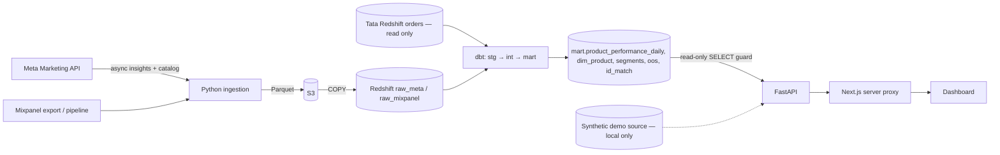

# Architecture & feature map

## Capability map (ROI Hunter / DeltaX-style → this repo)
| Capability | Where | Status |
|---|---|---|
| Per-SKU spend, CPM, CTR, CPC, impressions, link clicks | ingestion Pull B → `mart.product_performance_daily` → Products page | built, unvalidated |
| Product ROAS from first-party revenue (Meta has no per-product conversions) | dbt M1–M4 attribution | built, unvalidated |
| Attribution model comparison | `/attribution/compare`, Attribution page | built, unvalidated |
| Spend reconciliation / unallocated spend | `mart.spend_reconciliation`, Data Health | built, unvalidated |
| Product segmentation (Stars/Gems/Bleeders/Zombies) | `config/segments.yml`, `mart.product_segments`, Segments page | built, demo data |
| Business-rule recommendations (scale/exclude/pause) | `config/rules.yml`, Recommendations page | built, recommendation-only |
| Out-of-stock spend detection | `mart.oos_spend_daily` | built (latest availability only) |
| Spend concentration (Pareto) | Overview | built |
| Margin / returns / COGS, POAS | — | Phase 2 (needs source) |
| Feed write-back (custom labels / product sets) | — | Phase 2, approval-gated, **not built** |
| Other channels (Google, TikTok, Snap) | — | Phase 3 |
